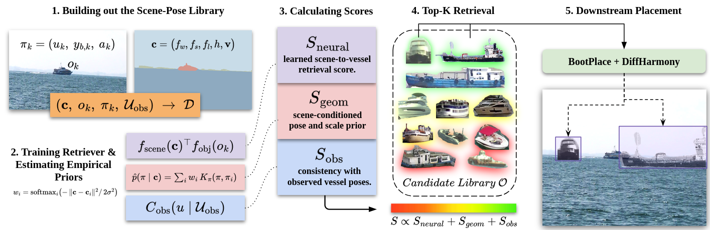
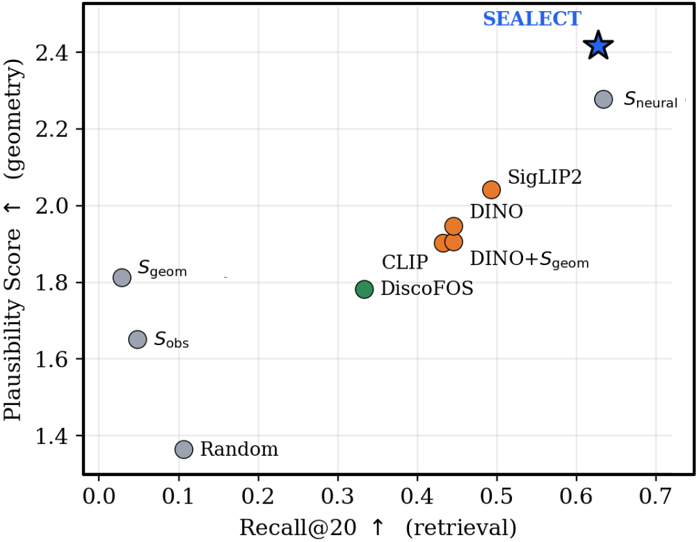
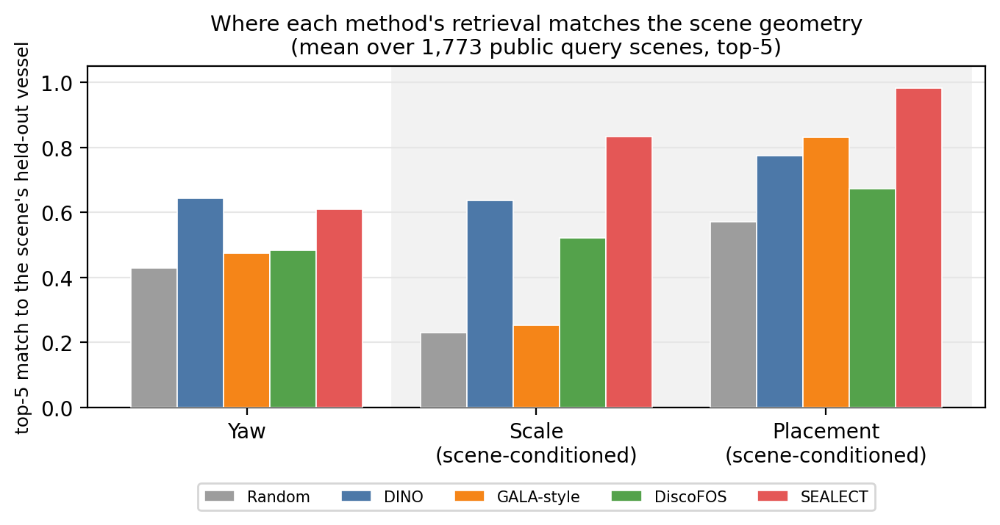
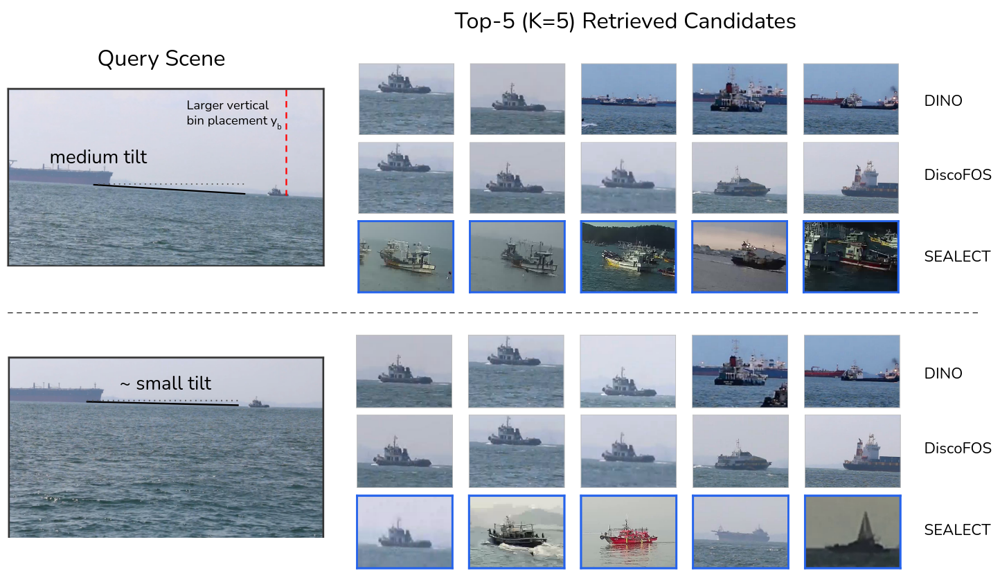

<div align="center">

# SEALECT

### Scene-Conditioned Pose Priors for Plausible Maritime Vessel Retrieval

**Faisal Mohammad**<sup>1,2</sup> &nbsp;·&nbsp; **Mohamed Younis**<sup>1</sup>

<sup>1</sup>University of Maryland, Baltimore County &nbsp;&nbsp; <sup>2</sup>Johns Hopkins University Applied Physics Laboratory


[](LICENSE)




</div>

> **TL;DR** — Copy-paste augmentation for maritime imagery usually asks *where* to put a vessel. SEALECT asks *which* vessel to put there: it retrieves candidates whose pose, scale, and placement fit the background's viewpoint and water/sky/horizon layout, using a training-free, scene-conditioned prior on top of a learned retriever.

## 📰 News

- **2026-10** — SEALECT is accepted to **WACV 2027** (Applications Track). 🎉

## ✨ Highlights

- **Selection, not placement.** We recast maritime augmentation as scene-conditioned *retrieval*: which real vessel crop belongs in this scene, before any placement or harmonization model runs.
- **A prior with no learned parameters.** Plausible pose, placement, and scale are read off a scene–pose library with a Nadaraya–Watson-style kernel over scene descriptors, so the prior needs no training and degrades gracefully where pose labels are sparse.
- **Better geometry at near-best recall.** SEALECT has the highest plausibility of every method and more than halves the constraint violations of appearance retrieval (2.7% vs. 6.6% for DINOv2) while keeping 99% of the retriever's recall.
- **Holds up after rendering.** With BootPlace placement and DiffHarmony harmonization, SEALECT is the top-ranked insertion on 40.5% of scenes, 2.5× the next-best method, and ranks first of six methods in a blind human study.

## 🧭 Method

SEALECT ranks every candidate vessel $o_j$ for a query scene with a fused score

```math
S_j \;=\; \lambda_n\,S_{\text{neural}}(j) \;+\; \lambda_g\,S_{\text{geom}}(j) \;+\; \lambda_o\,S_{\text{obs}}(j)
```

| Term | What it measures | Learned? |
|---|---|---|
| $S_{\text{neural}}$ | Two-tower scene–candidate compatibility over DINOv2 appearance and placement geometry | ✅ InfoNCE |
| $S_{\text{geom}}$ | Log-likelihood of the candidate's pose, placement, and scale under a kernel-weighted, scene-conditioned prior | ❌ empirical |
| $S_{\text{obs}}$ | Consistency with the poses of vessels already in the scene | ❌ empirical |

The geometric prior weights every library entry by how closely its scene (and target region) resembles the query,

```math
\hat p(\pi \mid \mathbf{c}_q) = \sum_i w_i(\mathbf{c}_q)\,k_\pi(\pi,\pi_i), \qquad
w_i(\mathbf{c}_q) = \operatorname{softmax}_i\!\left(-\frac{\lVert \mathbf{c}_q-\mathbf{c}_i\rVert^2}{2\sigma^2}\right)
```

and replacing it with a hard context bin lowers every retrieval metric.

## 📊 Results

Retrieval on a seven-benchmark maritime corpus ($K{=}20$; 68,338 candidates, 4,245 query scenes). **PS** is the mean number (0–4) of geometric attributes (pitch, yaw, placement, scale) on which a retrieved vessel matches the scene's held-out vessel.

| Method | Recall@20 ↑ | NDCG@20 ↑ | PS@20 ↑ | Joint-pose violations ↓ |
|---|:---:|:---:|:---:|:---:|
| Random | 0.106 | 0.726 | 1.364 | 12.0% |
| CLIP (ViT-B/32) | 0.432 | 0.801 | 1.903 | 7.3% |
| DINOv2 (ViT-S/14) | 0.445 | 0.810 | 1.947 | 6.6% |
| SigLIP 2 (B/16) | 0.493 | 0.814 | 2.042 | — |
| DiscoFOS (fine-tuned) | 0.333 | 0.770 | 1.783 | 7.5% |
| GALA-style | 0.107 | 0.813 | 1.672 | 8.3% |
| $S_{\text{neural}}$ only (our retriever) | **0.634** | 0.830 | 2.278 | 6.6% |
| **SEALECT** | 0.627 | **0.848** | **2.418** | **2.7%** |

The recall gain over appearance encoders comes from the trained retriever; the training-free prior then buys ranking quality and plausibility for a 0.007 drop in recall.

<table>
<tr>
<td width="50%"></td>
<td width="50%"></td>
</tr>
<tr>
<td align="center"><sub>SEALECT sits at the top-right of the recall–plausibility frontier.</sub></td>
<td align="center"><sub>Its top-5 matches the scene's scale and placement far more often than appearance or learned search.</sub></td>
</tr>
</table>

<p align="center">
<br>
<sub>Same target vessel, different viewpoint: SEALECT's top-5 changes completely (0/5 shared), while DINOv2 (4/5) and DiscoFOS (5/5) return nearly the same candidates.</sub>
</p>

**After rendering and with people in the loop.** After BootPlace + DiffHarmony, SEALECT is the per-scene top-1 insertion on 40.5% of composites (next best 15.7%) with the best mean rank (3.00). In a blind forced-choice study (1,110 comparisons, six naive raters), a Bradley–Terry fit ranks SEALECT first of six: significantly ahead of random and GALA-style selection and statistically tied with CLIP, DiscoFOS, and DINOv2.

## 🗂️ Repository layout

```
sealect2/                 ablation + reproduction harness for the retrieval tables
  legacy_bridge.py        imports the frozen paper scorer and exposes raw S_neural / S_geom / S_obs
  context_kernel.py       the kernel-conditioned scene prior (SEALECT)
  run_ablation.py         run any variant (A0_baseline = discrete-bin SEALECT, B3_kernel_prior = SEALECT)
  eval_full.py            Recall / NDCG / PS + distributional + plausibility -> runs_summary.csv
  sweep_bandwidth.py sweep_lambda.py   kernel-bandwidth and fusion-weight tables
  camera_ready_analysis.py   latency, kernel concentration, observation-term fallback
  variants/               one folder per ablation (A: fusion, B: prior, C: retriever)
  downstream/             downstream detector experiment
experiments/
  experiment1/            frozen scorer, retrieval metrics, baselines (GALA-style, DiscoFOS, encoders)
  experiment2/ experiment3/   distributional-alignment and pose-plausibility evaluators
  experiment4/            qualitative retrieval panels
  experiment5_1/          rendered pose–scene compatibility (BootPlace + DiffHarmony)
  dataset_decide/         decorrelated train/test split + scene-conditioned prior builder
scripts/                  pose estimator (PoseNet) training / evaluation, symmetry-aware SO(3) geodesic
scripts_new/              scene–pose library + descriptor build, pose labelling
wacv_sealect/             paper figures (incl. make_fig4_axis_decomp.py) and the human study
assets/                   README figures
```

## ⚙️ Installation

```bash
git clone https://github.com/fossil-ai/SEALECT.git
cd SEALECT
python -m venv .venv && source .venv/bin/activate
pip install -r requirements.txt
```

Python ≥ 3.10. The retrieval tables need only `torch`, `numpy`, and `tqdm` given a prebuilt library, splits, prior, and retriever. The encoders, library build, and rendering pipeline pull heavier, mostly auto-downloaded dependencies (see `requirements.txt`).

## 📦 Data and weights

No images or model weights are distributed. Scripts carry placeholder paths of the form `/path/to/sealect_root/...` and `/path/to/datasets/...`; point them at your copies. You will need:

- **Six public maritime benchmarks:** [ABOships](https://doi.org/10.3390/rs13050988), [KOLOMVERSE](https://doi.org/10.1109/TITS.2024.3449122), [LaRS](https://lojzezust.github.io/lars-dataset/), [SMD](https://sites.google.com/site/dilipprasad/home/singapore-maritime-dataset), [SeaDronesSee](https://seadronessee.cs.uni-tuebingen.de/), and [SeaShips](https://doi.org/10.1109/TMM.2018.2865686). The paper's seventh source is an access-restricted in-house UAV set; it appears in the code only under the opaque labels `RESTRICTED_A` / `RESTRICTED_B` and is never distributed.
- **Encoders:** DINOv2 (`torch.hub`); CLIP, SigLIP 2, SegFormer, and Grounding DINO (Hugging Face); [SAM 2](https://github.com/facebookresearch/sam2) for library masks and downstream cutouts.
- **Rendering (Table 5 only):** the external [BootPlace](https://github.com/RyanHangZhou/BOOTPLACE) and [DiffHarmony](https://github.com/nicecv/DiffHarmony) repositories and weights.

Small derived artifacts ship so the tables can be rebuilt without re-running everything: the scene-conditioned prior, the split summary, per-dataset pose metrics, and the ablation summaries.

## 🔁 Reproducing the paper

```bash
# (optional) rebuild data from the raw benchmarks
python scripts/pose3.py                                                  # train the pose estimator
python scripts_new/build_merged_scene_pose_library_grounded_sam2.py     # scene–pose library
python experiments/dataset_decide/make_dino_decorrelated_kbalanced_train_test_split.py
python experiments/dataset_decide/build_scene_pose_prior.py
python experiments/experiment1/train_sealect_neural_retriever_grounded_sam2.py

# retrieval, distributional, and plausibility tables (+ bandwidth and fusion-weight sweeps)
cd sealect2
python verify_baseline.py                          # gate: reproduces the frozen scorer exactly
python run_ablation.py --variant B3_kernel_prior   # SEALECT
python run_ablation.py --variant A0_baseline       # discrete-bin ablation
python eval_full.py                                # -> runs_summary.csv
python sweep_bandwidth.py && python sweep_lambda.py
CUDA_VISIBLE_DEVICES="" python camera_ready_analysis.py   # latency, kernel concentration
cd ..

# baselines
python experiments/experiment1/run_retrieval_eval_all_methods.py        # CLIP / DINOv2 / SigLIP 2 / random
python experiments/experiment1/run_gala_baseline.py
python experiments/experiment1/build_discofos_maritime_data.py && \
python experiments/experiment1/train_discofos_maritime.py && \
python experiments/experiment1/run_discofos_eval.py

# pose accuracy, rendered compatibility, downstream detector
python scripts/eval_symgeo.py
python experiments/experiment5_1/09_rendered_pose_scene_compatibility_eval_pairwise_fixed.py
python sealect2/downstream/expA_train2.py

# figures and the human-study scorer
python wacv_sealect/make_fig4_axis_decomp.py
python wacv_sealect/make_analysis_figs.py
python wacv_sealect/human_eval/arena_score.py <dir-of-rater-csvs>/
```

`sealect2/` does not re-implement scoring: it imports the frozen paper scorer through `legacy_bridge.py` and reuses the original evaluators, so results match the paper exactly. Run it from inside `sealect2/`.

### Human study

`wacv_sealect/human_eval/arena_score.py` (standard library only) joins per-rater CSVs with `manifest_private_arena.json`, the composite-to-method key, and prints the Bradley–Terry leaderboard, pairwise win rates, and Fleiss' κ. The study's rating site is preserved on the [`human-eval-arena`](https://github.com/fossil-ai/SEALECT/tree/human-eval-arena) branch. Individual ratings are not distributed.

## 📝 Citation

If you find SEALECT useful, please cite:

```bibtex
@inproceedings{mohammad2027sealect,
  title     = {{SEALECT}: Scene-Conditioned Pose Priors for Plausible Maritime Vessel Retrieval},
  author    = {Mohammad, Faisal and Younis, Mohamed},
  booktitle = {Proceedings of the IEEE/CVF Winter Conference on Applications of Computer Vision (WACV)},
  year      = {2027}
}
```

## 🙏 Acknowledgments

We thank the Johns Hopkins University Applied Physics Laboratory for supporting the first author's graduate studies. SEALECT builds on [BootPlace](https://github.com/RyanHangZhou/BOOTPLACE), [DiffHarmony](https://github.com/nicecv/DiffHarmony), [SAM 2](https://github.com/facebookresearch/sam2), [Grounding DINO](https://github.com/IDEA-Research/GroundingDINO), [DINOv2](https://github.com/facebookresearch/dinov2), and the public maritime benchmarks listed above.

## 📄 License

Released under the [MIT License](LICENSE).
